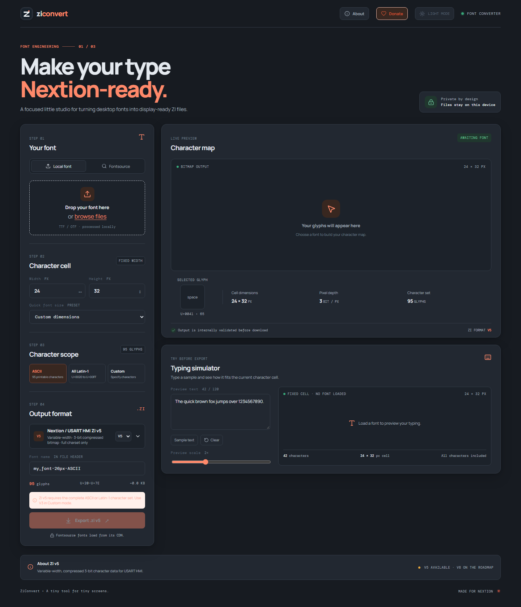

# ZiConvert

<p align="center">
  <strong>A browser-based font studio for Nextion and USART HMI displays.</strong><br />
  Convert local TTF and OTF fonts into ZI files, preview glyphs, and validate output before export.
</p>

<p align="center">
  <a href="https://nodejs.org/"></a>
  
  
  
  
</p>

ZiConvert runs font conversion in your browser. Local font files are not uploaded to a conversion server. You can load a font from your device or browse hosted fonts through [Fontsource](https://fontsource.org/).

## Screenshot



## Contents

- [Highlights](#highlights)
- [Screenshot](#screenshot)
- [Get started](#get-started)
- [How to use](#how-to-use)
- [Supported formats](#supported-formats)
- [Privacy and network requests](#privacy-and-network-requests)
- [Development](#development)
- [Project structure](#project-structure)
- [Credits](#credits)
- [Support my work](#support-my-work)
- [License](#license)
- [Format references](#format-references)

## Highlights

- Import local `.ttf` and `.otf` files, or search the Fontsource catalog.
- Choose printable ASCII, the supported Latin-1 range, or a custom character range.
- Set cell dimensions directly or start with a size preset.
- Preview the glyph map and identify characters that may be clipped.
- Test text in the typing simulator with adjustable preview scale and character-set warnings.
- Export structurally validated ZI v3 or ZI v5 files.
- Use light or dark theme; your preference is saved in the browser.
- View project and developer information in the About panel.

## Get started

### Requirements

- Node.js 20.19+ or 22.12+ and npm
- A modern browser with Canvas 2D, `FontFace`, and Blob download support

### Run locally

```bash
npm ci
npm run dev
```

Open the local URL printed by Vite in your browser.

## How to use

1. Select **Local font** to choose or drop a TTF/OTF file, or select **Fontsource** to search its catalog.
2. Choose a size preset or set the character-cell width and height.
3. Select printable ASCII, the full supported Latin-1 range, or enter custom characters.
4. Review the glyph map and resolve any clipping warnings.
5. Set the font name stored in the ZI header.
6. Enter sample text in the typing simulator to check how the font fits the selected cell and character set.
7. Choose **Export .zi file** to validate and download the font.
8. Test the generated file in USART HMI or Nextion Editor and on your target display before using it in a project.

Both encoders require integer cell dimensions from 1 to 255 pixels. ZI v3 also requires `width × height` to be divisible by 8. ZI v3 stores a continuous character range, so gaps between custom characters are included in the output. Custom characters must be between U+0020 and U+00FF. Export is disabled for invalid dimensions and detected clipping.

## Supported formats

| Format | Character sets | Pixel data | Cell dimensions |
| --- | --- | --- | --- |
| **ZI v3** | Printable ASCII (95 glyphs), full supported Latin-1 (U+0020–U+00FF), or a custom continuous range | 1-bit monochrome, fixed-width glyphs | 1–255 px; width × height must be divisible by 8 |
| **ZI v5** | Complete printable ASCII or complete supported Latin-1; custom subsets are not supported | 3-bit antialiased data, variable glyph widths | 1–255 px |

ZI v6 is not supported. Custom subsets in v5 require v6 mode, which is not implemented. ZI is a proprietary format: structural validation does not guarantee compatibility with every editor or display, so test exported files with your target hardware.

The included `robo-52-bold.zi` file is a v6 variable-width sample for format inspection. ZiConvert cannot load or convert it.

## Privacy and network requests

- **Local fonts:** Read and processed in the browser; font bytes are not sent to a conversion backend.
- **Fontsource fonts:** Catalog data and the selected font are fetched directly from Fontsource's catalog and CDN.
- **Interface fonts:** Manrope and DM Mono are loaded from Google Fonts, which may receive requests when the UI loads.
- **Storage:** ZiConvert does not provide cloud storage or retain a local font after the page is closed.

Fontsource search and hosted fonts, as well as the interface fonts, require an internet connection. Local font conversion does not upload the selected file.

## Development

Run the encoder unit tests:

```bash
npm test
```

Type-check the project and create the static production bundle in `dist/`:

```bash
npm run build
```

Preview the production bundle locally:

```bash
npm run preview
```

The static site can be deployed to a static hosting provider. Vite uses the relative base path `./` to support hosting under a subpath. GitHub Actions runs the tests and production build on pushes and pull requests.

## Project structure

```text
ZiConvert/
├── .github/
│   └── workflows/
│       └── ci.yml              # GitHub Actions test and build workflow
├── public/
│   ├── favicon.svg             # Browser and navbar icon
│   ├── qr-code.svg             # Tako donation QR code
│   └── ziconvert-screenshot.png # Full-page dark mode screenshot
├── src/
│   ├── lib/
│   │   ├── fonts/
│   │   │   └── rasterize.ts    # Render font glyphs to pixel data
│   │   └── zi/
│   │       ├── v3.ts           # ZI v3 encoder and inspector
│   │       ├── v3.test.ts      # ZI v3 encoder tests
│   │       ├── v5.ts           # ZI v5 encoder and inspector
│   │       ├── v5.test.ts      # ZI v5 encoder tests
│   │       └── types.ts        # Shared glyph and format types
│   ├── App.tsx                 # Main converter interface
│   ├── main.tsx                # React application entry point
│   ├── styles.css              # Application styles
│   └── vite-env.d.ts           # Vite client type declarations
├── .gitignore
├── LICENSE                    # MIT License with Commons Clause
├── index.html                 # Vite HTML entry point
├── package-lock.json          # Locked dependency versions
├── package.json               # Scripts and dependencies
├── README.md
├── robo-52-bold.zi            # ZI v6 inspection sample
├── tsconfig.json              # TypeScript project references
├── tsconfig.app.json          # Application TypeScript configuration
├── tsconfig.node.json         # Tooling TypeScript configuration
├── vite.config.ts             # Vite configuration
└── vitest.config.ts            # Vitest configuration
```

Generated output (`dist/`) and installed dependencies (`node_modules/`) are generated locally and ignored by Git, so they are not listed in the source tree.

## Credits

Font search and hosted font delivery are powered by [Fontsource](https://fontsource.org/). Font files remain subject to their respective licenses.

ZiConvert is created and maintained by [baaaaan1](https://github.com/baaaaan1).

The **About** panel in the application provides a brief project overview and a link to the developer's GitHub profile.

## Support my work

If ZiConvert or my other projects have been useful to you, you can optionally support my work through [tako.id](https://tako.id/Baaaaan1). Tips help fund hardware prototypes, components, testing, and future projects. Donations are voluntary and do not purchase access, features, or support services for ZiConvert.

<p align="center">
  <a href="https://tako.id/Baaaaan1"></a><br />
  <sub>Scan or click the QR code to visit <a href="https://tako.id/Baaaaan1">tako.id/Baaaaan1</a>.</sub>
</p>

## License

ZiConvert is provided under the [MIT License](LICENSE), subject to the **Commons Clause License Condition v1.0**. You may use, modify, and redistribute ZiConvert in open-source or closed-source projects, provided you retain the copyright and license notices. You may not sell ZiConvert itself, or offer it as a paid hosted service or support service when the value derives entirely or substantially from ZiConvert's functionality. Contact [baaaaan1](https://github.com/baaaaan1) for separate permission to sell or commercially host ZiConvert.

This restriction applies to the **ZiConvert software**, not to fonts or other output created with it. ZiConvert does not claim ownership of exported font files. You may use exported files, including in commercial products, subject to the license and terms that apply to each source font. Check that font's license for any restrictions before distributing or using it commercially.

The MIT License with Commons Clause is source-available, not an OSI-approved open-source license. See the [Commons Clause FAQ](https://commonsclause.com/) for details about its scope.

## Format references

- [Nextion Font Editor repository](https://github.com/hagronnestad/nextion-font-editor)
- [ZI v3 format specification](https://github.com/hagronnestad/nextion-font-editor/blob/master/Docs/Nextion%20Font%20Format%20Specification%20ZI%20version%203.md)
- [ZI v5 format specification (work in progress)](https://github.com/hagronnestad/nextion-font-editor/blob/master/Docs/Nextion%20Font%20Format%20Specification%20ZI%20version%205.md)
